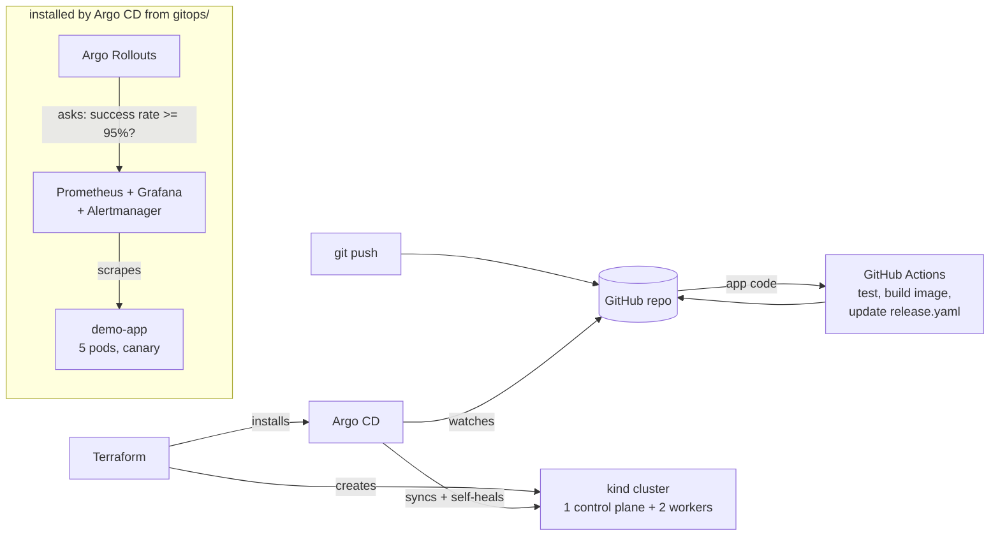

# Platform Lab

**A self-healing mini cloud platform that runs on a laptop: Kubernetes, GitOps, infrastructure as code, monitoring, and canary releases that roll back on their own.**

[](https://github.com/GowthamReddyKotha14/platform-lab/actions/workflows/ci.yml)

One command builds a 3-node Kubernetes cluster. From then on, **Git is the only way anything changes**: Argo CD keeps the cluster matching this repo, Prometheus watches everything, and a new release only reaches all users if the metrics say it's healthy.

The demo script breaks the platform on purpose and times the recovery: killing a pod, powering off a whole node, changing things by hand, and pushing a deliberately broken release.

## How it works



| Layer | Tool | Where |
|---|---|---|
| Infrastructure as code | Terraform (kind + Helm providers) | `infra/terraform/` |
| GitOps | Argo CD, app-of-apps | `gitops/apps/` |
| Workload | Python service with Prometheus metrics, 5 replicas spread across nodes | `app/`, `gitops/workloads/demo-app/` |
| Safe releases | Argo Rollouts canary: 20% of pods, then a Prometheus check, then 60%, then 100% | `rollout.yaml`, `analysis-template.yaml` |
| Observability | Prometheus, Grafana dashboard, 3 alert rules | `servicemonitor.yaml`, `alerts.yaml`, `dashboard.yaml` |
| CI/CD | Tests, manifest validation against Kubernetes schemas, `terraform validate`, multi-arch image build | `.github/workflows/` |

## Run it on a Mac

**You need:** Docker Desktop (Settings → Resources → at least **6 GB memory**), plus:

```bash
brew install kind kubectl terraform
```

**Then:**

```bash
make up        # cluster + Argo CD (about 3 minutes)
make status    # watch Argo CD install the rest from Git (about 5 more minutes)
make grafana   # dashboards: http://localhost:3000  (admin / platform-lab)
make argocd    # GitOps UI:  http://localhost:8080  (prints the admin password)
make demo      # break things on purpose, time the recovery -> results/demo.json
make down      # delete everything
```

## Design decisions

**1. Terraform builds the foundation, Git runs everything else.** Terraform only creates the cluster and installs Argo CD. Every app, including monitoring, is installed by Argo CD from `gitops/`. So there's exactly one way to change what runs, and the Git history is a full audit log.

**2. A release is a commit.** CI doesn't deploy anything; it builds an image and edits `release.yaml`. Argo CD sees Git change and rolls it out. Rolling back is `git revert`.

**3. Health checks aren't enough to judge a release.** The broken release in the demo still passes every probe, but 30% of user requests fail. Only a metric about real requests can catch that, so the canary is gated on success rate from Prometheus, measured per release via each pod's rollout hash.

**4. Self-healing means putting Git back, not just restarting.** Kubernetes restarts dead pods. Argo CD's `selfHeal` goes further: a Service deleted by hand or replicas changed by hand get reset to what Git says.

**5. Spread pods, and don't wait 5 minutes on a dead node.** Topology spread keeps pods on both workers. Kubernetes normally waits 300 s before moving pods off an unreachable node; 20 s tolerations make failover fast.

**6. Pinned versions.** Argo CD chart 7.8.9, Argo Rollouts 2.39.6, kube-prometheus-stack 69.8.2. Nothing floats to `latest`, so a rebuild next month behaves the same.

## Tests

```bash
pytest -q tests app/tests      # 6 tests: app behavior and metrics, demo release-file editing
```

CI also renders every manifest with kustomize and validates it against the Kubernetes and CRD schemas, and runs `terraform fmt` and `terraform validate`.

## Limits

- It's a local cluster. kind nodes are Docker containers, so "powering off a node" means stopping a container, not pulling a cable.
- The Grafana password is fixed because it's a local demo; a real platform would use a secrets manager.
- Canary traffic is split by pod count (1 of 5 pods = 20%), not by a service mesh.

## License

MIT
